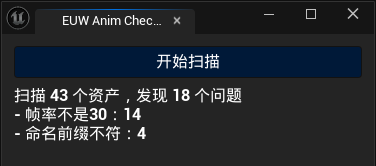
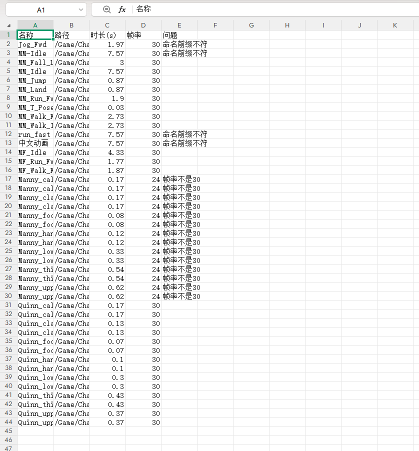

# ue-anim-checker

UE5小工具，扫描动画资产，检查命名和帧率，输出 CSV 报告。

## 目的
减少逐个点开动画检查命名和帧率的工作量。

## 使用

### 前置条件
- UE 5.4.4
- 启用 `Python Editor Script Plugin`
  （编辑 → 插件 → 搜 Python → 勾选 → 重启）

### 方式一：编辑器面板（推荐）
1. 把 `check_anims.py` 放到任意目录（建议 `项目/Content/Python/`）
2. 把 `ue/EUW_AnimChecker.uasset` 导入项目 `Content/`
3. 右键 `EUW_AnimChecker` → `运行编辑器实用工具`
4. 点击「开始扫描」
5. 结果出现在面板；同时生成 `report.csv`（在脚本同目录）

### 方式二：命令行
1. 打开 `窗口 → 输出日志`，输入框切到 `Python`
2. 输入 `py "路径/check_anims.py"`
3. 汇总打印在日志，`report.csv` 生成在脚本同目录

### 输出说明
| 输出 | 内容 |
|---|---|
| 面板 | 资产总数、问题数、按类型统计 |
| `report.csv` | 每个资产一行：名称 / 路径 / 时长 / 帧率 / 问题 |

### 修改检查规则
编辑 `check_anims.py` 顶部三个常量：
- `ASSET_ROOT`：扫描根目录（默认 `/Game`）
- `EXPECTED_FPS`：目标帧率（默认 30）
- `ALLOWED_PREFIXES`：命名白名单

## 输出示例
  

## 样例输出结果
扫描 43 个资产，发现 18 个问题（14 个帧率、4 个命名）。

## 已测试
- 空白项目（0 个资产）：正常输出，无报错
- 中文路径：正常生成 CSV
- 连续运行两次：结果一致

## 限制
- 只扫 /Game 目录（写死在顶部常量，可改）。
- 只检查 AnimSequence，不检查 Montage / BlendSpace
- 面板需要手动点击触发，暂不支持批量/CI 自动执行
- 每次都会重新加载全部资产

## 环境
UE 5.4.4 · 脚本内使用引擎自带 Python
